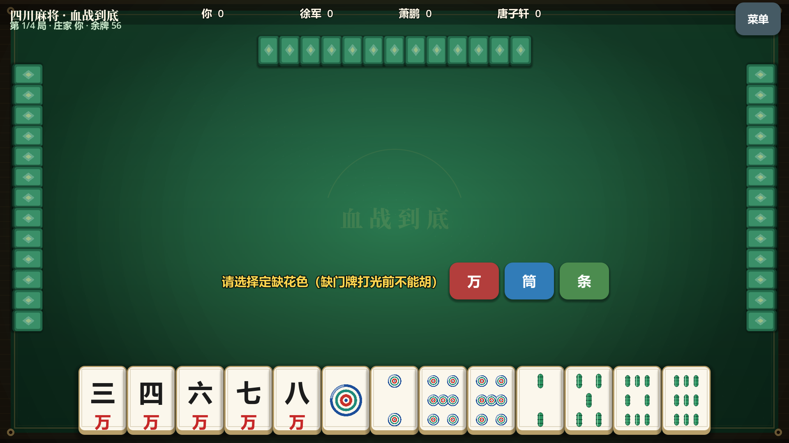

# 单机麻将 · 四川麻将（血战到底）

Godot 4.7 单机四川麻将，横屏手机版（1920×1080 设计，手牌沿屏幕最长的底边排列）。



## 功能
- 四川麻将（血战到底）：开局定缺、只能碰/杠/胡（无吃；和牌可含自摸形成的顺子，即平胡；另有碰碰胡、七对）、一人和牌后其余人继续直到牌摸完、杠牌即时收分
- 三个对手 AI（基于向听数，难度随机化），每局随机生成真实感的中文昵称
- 开局每人定缺一门，牌桌上方的彩色“缺万/缺筒/缺条”标签全程显示每家的选择
- 一局结束后翻开所有 AI 的手牌，便于复盘
- **刚摸到的牌单独摆在手牌最右侧并高亮**，不会和整理后的手牌混在一起
- **听牌提示**：右下角实时显示“打 三万 → 听 一万、四万（剩 5 张）”，并按已现身的牌扣掉张数
- **设置面板**（菜单 / 暂停面板均可进入）：出牌节奏（快/中/慢）、音效/人声音量、静音、震动；设置保存在 `user://settings.cfg`
- **玩法说明**：可从菜单或暂停面板点击打开，不会在启动时自动弹出
- **暂停与确认**：菜单按钮或 Esc 打开暂停面板（继续 / 设置 / 重新开始 / 返回菜单），中途退出不再丢失协程，结算后可“再来一场”
- 出牌交互：点选牌（抬起 + 金色描边），再点一次打出；不能打的牌变暗。桌面端可用 ←/→ 选牌、回车/空格打出
- 炫酷动效：出牌弧线飞行 → 落地冲击波 + 粒子 + 震屏；胡牌金色闪光与烟花
- 音效：程序化合成的出牌挥击声；落地撞击音按花色区分材质（万=石、筒=玻璃、条=木）并随点数变调；碰/杠号角；胡牌和弦
- 人声：每张牌落地后报牌名（如“二万”“三条”），碰/杠/暗杠/补杠/胡/自摸时播放叫牌词；落地处同时弹出文字提示。四个座位用不同音高区分说话的人
- 碰/明杠时会标注这张牌来自哪一家（“来自张伟的三万”）
- 结算：列出每家的番种与输赢、以及“谁 → 谁 多少（胡牌/杠分）”的收付明细
- 牌面：万、筒（同心环）、条（翡翠竹条，一条为小鸟）按传统麻将样式绘制
- 牌数：四川麻将无王牌，108 张 = 余牌 + 各家手牌与副露 + 牌河。发牌每人 13 张后余牌 56 张；杠后从牌尾补牌
- 牌河：四家出的牌按先后顺序合并平铺在桌面中央（18 列，较大的牌面）
- 特效：选牌火花、叫牌（碰/杠/胡/自摸）放射光线与大字、胡牌彩纸与烟花、牌桌漂浮光点
- 牌桌：木质桌框、毡布光晕与纹理、金色描边；标题使用思源宋体，正文使用思源黑体


## 目录结构
```
scripts/
  core/            纯逻辑（无 UI 依赖）
	tile.gd, tile_wall.gd, meld.gd, hand.gd
	win_checker.gd, win_context.gd, win_result.gd
	settings.gd   设置项与音频总线（SFX / Voice）
	rules/         mahjong_rule.gd（基类） + sichuan_rule.gd
	players/       player.gd, human_player.gd, ai_player.gd, name_gen.gd
	game/          round_controller.gd（一局）, match_controller.gd（整场）
  ui/              main.gd, menu_view.gd, game_view.gd, tile_view.gd,
                   settings_view.gd, fx.gd, vfx.gd（光点/放射光线/彩纸）, ui_font.gd
  audio/           sfx.gd（播放器池 + 人声）
assets/
  fonts/NotoSansSC.ttf    正文字体
  fonts/NotoSerifSC.ttf   标题字体
  sfx/*.wav               程序合成的音效
  voice/*.wav             报牌与叫牌人声（33 段）
```

## 导出 Android APK

本项目使用 Godot 4.7 stable 和仓库内的 `Android` 导出预设，默认生成仅支持 **arm64-v8a** 的调试 APK。可在 GitHub 仓库的 **Actions → Android debug APK → Run workflow** 手动运行构建，完成后从该次运行的 Artifacts 下载 `MahjongArena-debug-apk`。工作流使用临时调试签名，适合安装测试；不同构建的签名可能不同，不能保证直接覆盖安装，不适合发布到应用商店。

也可在本地安装 Godot 4.7 stable、对应版本的导出模板、JDK 17 和 Android SDK（含 platform-tools、build-tools），在 Godot 编辑器设置中配置 Java SDK、Android SDK 和调试密钥，然后执行：

```sh
mkdir -p export
godot --headless --editor --path . --import
godot --headless --path . --export-debug Android export/MahjongArena-debug.apk
```

正式发布需要使用自己的长期保存的发布密钥及独立的 release 导出配置，不要将密钥提交到仓库。
