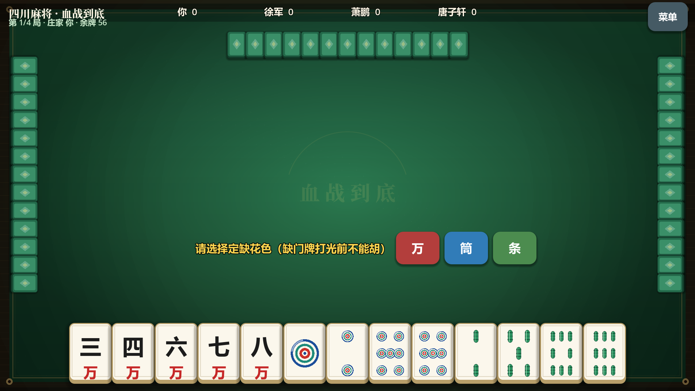

# 单机麻将 · 四川麻将（血战到底）

Godot 4.7 单机四川麻将，横屏手机版（1920×1080 设计，手牌沿屏幕最长的底边排列）。



## 功能
- 四川麻将（血战到底）：开局定缺、只能碰/杠/胡（无吃；和牌可含自摸形成的顺子，即平胡；另有碰碰胡、七对）、一人和牌后其余人继续直到牌摸完、杠牌即时收分
- 三个对手 AI（基于向听数，难度随机化），每局随机生成真实感的中文昵称
- 开局每人定缺一门，牌桌上方的彩色“缺万/缺筒/缺条”标签全程显示每家的选择
- 一局结束后翻开所有 AI 的手牌，便于复盘
- 动画节奏固定为最慢档，方便观察其他玩家的出牌过程
- 出牌交互：点选牌（抬起 + 金色描边），再点一次打出；不能打的牌变暗
- 炫酷动效：出牌弧线飞行 → 落地冲击波 + 粒子 + 震屏；胡牌金色闪光与烟花
- 音效：程序化合成的出牌挥击声；落地撞击音按花色区分材质（万=石、筒=玻璃、条=木）并随点数变调；碰/杠号角；胡牌和弦
- 人声：每张牌落地后报牌名（如“二万”“三条”），碰/杠/暗杠/补杠/胡/自摸时播放叫牌词；落地处同时弹出文字提示。菜单中可“试听人声”检查声音输出
- 牌面：万、筒（同心环）、条（翡翠竹条，一条为小鸟）按传统麻将样式绘制
- 牌数：四川麻将无王牌，108 张 = 余牌 + 各家手牌与副露 + 牌河。发牌每人 13 张后余牌 56 张；杠后从牌尾补牌
- 牌河：四家出的牌按先后顺序合并平铺在桌面中央（18 列，较大的牌面）
- 特效：选牌火花、叫牌（碰/杠/胡/自摸）放射光线与大字、胡牌彩纸与烟花、牌桌漂浮光点
- 牌桌：木质桌框、毡布光晕与纹理、金色描边；标题使用思源宋体，正文使用思源黑体

## 目录结构
```
scripts/
  core/            纯逻辑（无 UI 依赖）
	tile.gd, tile_wall.gd, meld.gd, hand.gd
	win_checker.gd, win_context.gd, win_result.gd
	rules/         mahjong_rule.gd（基类） + sichuan_rule.gd
	players/       player.gd, human_player.gd, ai_player.gd, name_gen.gd
	game/          round_controller.gd（一局）, match_controller.gd（整场）
  ui/              main.gd, menu_view.gd, game_view.gd, tile_view.gd, fx.gd, ui_font.gd
  audio/           sfx.gd（播放器池）
  ui/vfx.gd        额外特效（光点、放射光线、彩纸、漂浮光点）
assets/
  fonts/NotoSansSC.ttf    中文字体
  sfx/*.wav               由 tools/gen_sounds.py 生成
  voice/*.wav             报牌与叫牌人声（33 段，由 tools/split_voice.py 切分）
  fonts/NotoSerifSC.ttf   标题字体
export/
```
